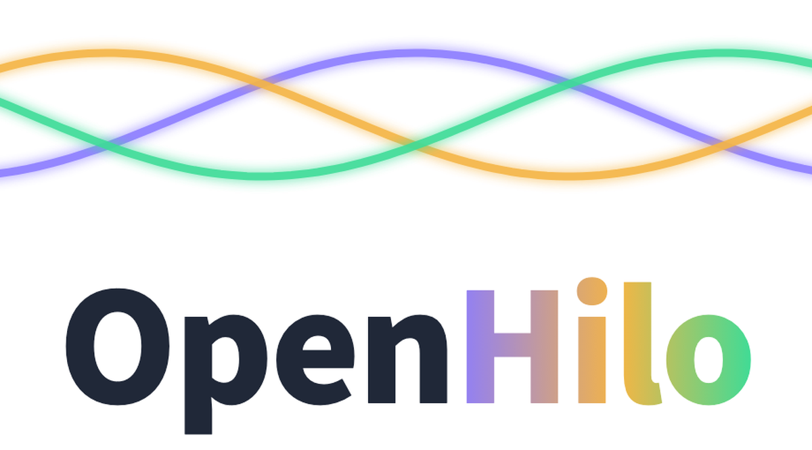
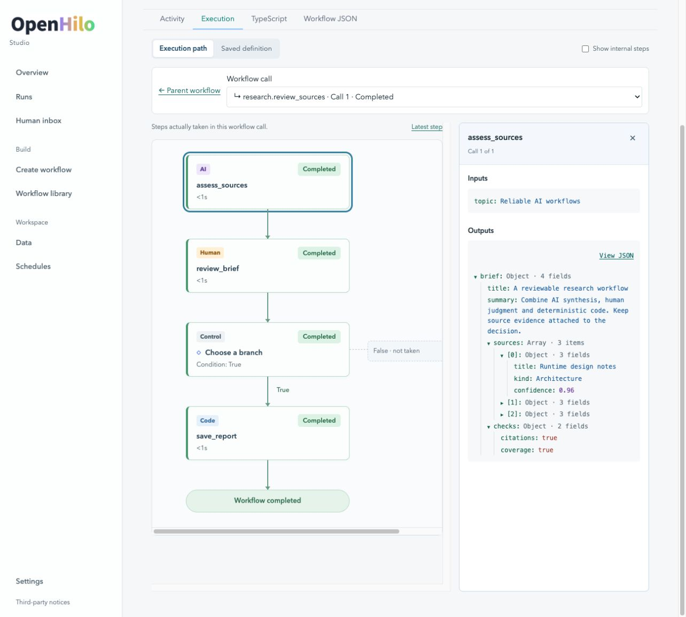

# OpenHilo Studio

[](https://github.com/OpenHilo/OpenHiloStudio/actions/workflows/ci.yml)

<p align="center"></p>

**Create, review and run workflows with AI, code and people.**

OpenHilo Studio is the local web application for [OpenHilo](https://github.com/OpenHilo/OpenHilo).
Describe a workflow, refine the draft with AI, review its TypeScript, then run it from the publication page. Follow live output, answer Human tasks and inspect nested calls, branches and iterations.

[](docs/assets/studio-execution.jpg)

*Drill into a child workflow, follow the path it took, and inspect nested results alongside each step. This example uses demonstration data and a scripted AI response. Click the screenshot to view it full size.*

- **Create:** keep a conversation while refining a draft; review each changed candidate before publication.
- **Run:** typed inputs, live AI output, explicit stop and checkpoint recovery for eligible failed steps.
- **Inspect:** Activity, execution paths, child-call definitions, TypeScript, inputs, results and failure diagnostics.
- **Collaborate with people:** durable Human requests, browser drafts and validated batch submissions.
- **Reuse data:** classes and entities that workflows can query across sessions and runs.
- **Schedule:** namespace-qualified workflows, cron schedules and run history.

## Run locally

Use **Node 22 or 24**, npm, Git, Bash and Python 3. The server uses SQLite; a supported native binding is required. Use a trusted local machine and keep the service on loopback.

Clone the repository, install its dependencies and build the application:

```sh
git clone https://github.com/OpenHilo/OpenHiloStudio.git
cd OpenHiloStudio
npm ci --ignore-scripts --no-audit --no-fund
npm run build
```

The install uses the checked-in lockfile and local OpenHilo dependency archives. It does not require another checkout or unpublished registry packages. The archives can be rebuilt from the pinned public OpenHilo commit without local patches; see the [rebuild procedure](vendor/openhilo/README.md#rebuild-from-public-source). SQLite prebuilt bindings are included for supported platforms. If SQLite cannot load, follow [SQLite binding troubleshooting](docs/operations.md#sqlite-binding-troubleshooting); `npm rebuild better-sqlite3` does not compile the locked 13.0.3 package. Do not delete a database to fix a binding error.

For the default Codex preset, install and authenticate Codex separately using the [OpenHilo guide](https://github.com/OpenHilo/OpenHilo/blob/main/docs/quickstart.md). Starting the server does not itself submit an AI request.

Choose a **new** data directory; `init` refuses existing directories. Port 3000 is an example: choose an unused port.

```sh
STUDIO_DATA="$HOME/openhilo-studio-data"
node apps/server/dist/local-cli.js init \
  --home "$STUDIO_DATA" \
  --config "$PWD/apps/server/examples/codex-local/config.example.json"
node apps/server/dist/local-cli.js start \
  --home "$STUDIO_DATA" \
  --composition "$PWD/apps/server/examples/codex-local/composition.cjs" \
  --studio "$PWD/apps/studio/dist/client" --host 127.0.0.1 --port 3000
```

Open <http://127.0.0.1:3000>. Use **Create workflow**, answer clarification questions, continue the conversation if needed and review the final draft. Publication offers **Run** with the workflow's input form. Subsequent starts use the same `start` command, without `init`.

For an account-free walkthrough, run `npm run demo`. AI responses are scripted; compilation, publication, SQLite, workers, Human pause/resume and Code execution are real. It creates a fresh temporary data directory and prints its location.

## Guides

- [Configuration and providers](docs/configuration.md): Codex, SDK and routed presets; active-time limits and stopping.
- [Workflows and recovery](docs/workflows.md): conversations, publication, Human tasks, failed-step recovery and inspection.
- [Local operation](docs/operations.md): data ownership, backups, shutdown and updates.
- [Development and verification](CONTRIBUTING.md): build, offline tests, packaging and independent consumers.
- [Inputs and results](docs/value-display.md): nested values, long text and raw JSON.
- [Testing and supported environments](docs/verification.md): CI coverage, reproducible checks and limitations.
- [Security boundary](SECURITY.md): trusted local operation and executable workflows.
- [Dependency provenance](vendor/openhilo/README.md): pinned core packages and compatibility identifiers.

## Modules

| Directory | Package | Responsibility |
| --- | --- | --- |
| `apps/studio` | `@openhilo/studio` | Browser UI and static assets |
| `apps/server` | `@openhilo/server` | HTTP API, local host and workers |
| `packages/platform-services` | `@openhilo/platform-services` | Data, history, scheduling, generation and publication |
| `packages/generation-contracts` | `@openhilo/generation-contracts` | Provider-independent generation policies |
| `adapters/human-studio` | `@openhilo/human-studio` | Human-task notification adapter |

The compiler, runtime and AI/Code adapters are maintained by OpenHilo. This repository contains their pinned dependency archives, not duplicate core source. Install from source using the steps above. The workspace packages are not currently distributed through npm; local tarballs are available for custom host integrations.

MIT licensed. Existing copyright notices are retained. Distributed dependencies keep their own licenses; see [THIRD_PARTY_NOTICES.txt](THIRD_PARTY_NOTICES.txt).
